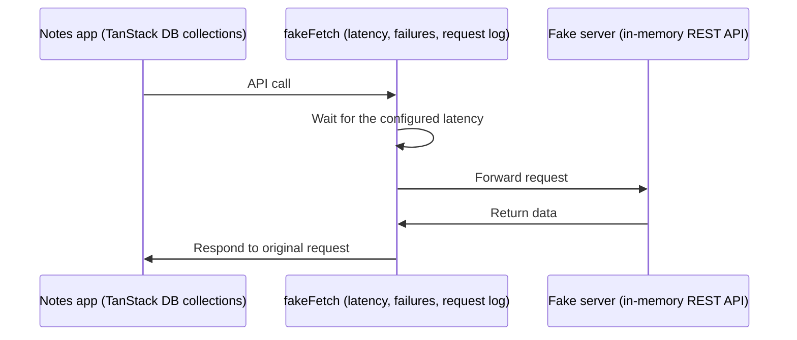

# trytanstackdb.com _(BETA version)_

> Note that this project is still in its early stages.

An interactive guide for taking the first steps with
[`@tanstack/db`](https://tanstack.com/db/latest/docs/overview) by
[fuko](https://fulop.dev/).

[🔗 trytanstackdb.com](https://trytanstackdb.com)

## 🚀 Main goals, motivations

It took a while for TanStack DB to "click" for me, but it's not because this
library is too nieche. When I used it for a POC and showed that to my
colleagues, they seemed to immediately understand the advantages of TanStack DB,
because I could show exactly the things I explained.

This project aims to bring the same interactive and practical learning
experience to everybody elseon the internet.

### Target audience

There are two types of people in the target audience of this project:

1. Devs, who just heard about TanStack DB, and want to understand what it is,
   and see if it could be useful for their use cases.
2. _(Future goal):_ People who want to build things with TanStack DB, and want
   to see a reference implementation of the features it has.

## Architecture

The architecture was designed around the two things that I wanted to highlight
in the interactive tutorial:

1. TanStack DB can make applications feel incredibly fast, even when the network
   latency is large
2. contrary to conventional local-first approaches, this library doesn't require
   big technical changes on the back end (works with any database, no need for
   adding new libs to your backend, simple api endpoints work just fine)

The guide runs next to a small Notes app built with TanStack DB. Its data lives
in three query collections (folders, notes, account) that load from and save to
a plain REST API.

Databases are expensive, so instead of running one on a server, the "backend"
is an in-memory database behind a small REST API that runs in the browser
(`src/api/fake-server.ts`). It is seeded from `src/fixtures` and starts over
when the page is reloaded.

I wanted to make the syncing mechanisms observable. The app only talks to the
API through `fakeFetch` (`src/api/fake-fetch.ts`), a `fetch`-like function that
waits for the configured latency, can fail the next request on purpose, and
records every request in a log. The network controls and the request inspector
in the UI are built on top of it.



## Development

The project is a [TanStack Start](https://tanstack.com/start) app that uses
[Vite+](https://viteplus.dev/) (the `vp` CLI) for tooling. See
[AGENTS.md](./AGENTS.md) for more about Vite+.

```sh
vp install      # install dependencies
vp run dev      # start the dev server on http://localhost:3000
vp check        # format, lint and type check
vp test         # run the unit tests
vp run build    # build for production
```

### Deployment

The app runs on Cloudflare Workers and deploys with the `cf` CLI. The worker
(`trytanstackdb-v2`) and its custom domain (`v2.trytanstackdb.com`) are set in
`cloudflare.config.ts`. `vp run deploy` runs `cf deploy`, which builds the app
with the Cloudflare Vite plugin and uploads it. The domain lives on the
Cloudflare account that owns the `trytanstackdb.com` zone, so `cf` must be
logged in to that account.

CI runs on TanStack Source (`.source/workflows/ci.ts`). It checks every pull
request into `v2`, and deploys each push to `v2` with the
`CLOUDFLARE_API_TOKEN` CI secret.
